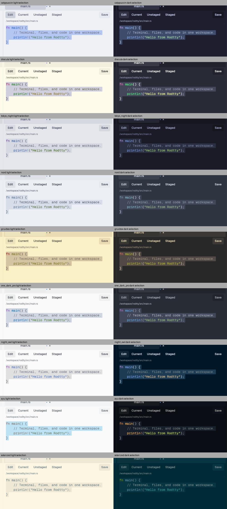
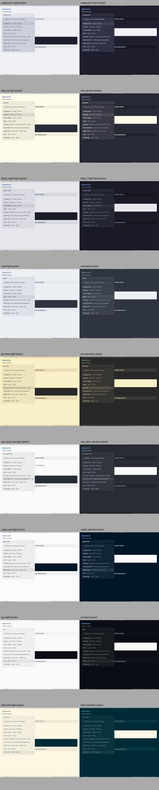

# Appearance verification

This is the historical T05 report. The later [integrated qualification](integrated-qualification.md#visual-evidence) records the final 18-appearance wide/minimum real-Git matrix, source freshness, and current gates.

The twelve families and twenty-four appearances use the shared workspace resolver.
[Palette sources and adaptations](../assets/themes/README.md) lists exact RGB
sources, immutable blob pins, full notices, and the deliberately adapted light
palettes. One Dark Pro Light is visibly labelled as a Rodtty adaptation.

Implementation evidence was captured on Linux x86-64 on 2026-11-16 against
integration `1e947ab`. Merger validation combines integration `7f0ff57` and T05
`5551e8f`; the documented serial suite passes all 106 tests with ignored tests
included (64 library, 10 file operations, 12 files/Git, 3 settings, 17 terminal).
Formatting, strict all-targets Clippy, all desktop binaries and the backend
without default features also pass. Test storage uses a dedicated target/tmp
and matching Git ceiling. The full suite ran outside the sandbox after the
known wait-timeout SIGCHLD fd write restriction aborted the sandbox run.
Windows/macOS native GUI checks remain pending.

The [machine-readable matrix](evidence/appearance-validation.json) records
180 rendered frames and their hashes: all eighteen explicit appearances at
1400×1000, every family's System light/dark appearances at 680×800, plus real
editor selections and open searchable compact theme pickers in all eighteen.
The workspace/editor, Settings/previews, command palette and read-only diff
scenes were inspected for clipping, focus, contrast and readable selections.

The native [Wayland](evidence/appearance-wayland.json) and actual
[Xlib](evidence/appearance-x11.json) lifecycle checks each apply 27 family/mode
changes against the same live terminal session. Output continues afterward,
while the window is closed, and after second-launch reattachment. These native
checks are separate from the labelled sample-content snapshots below.

## Settings and palettes


## Selected editor text



## Read-only diffs


## Compact family picker



## Reproducing a scene

Create an isolated `RODTTY_HOME` under the dedicated target directory, with
`settings.json` containing the desired `theme_family` and `appearance` values.
For example, `{"theme_family":"dracula","appearance":"light"}` selects Alucard.
Then run the normal developer renderer:

```sh
RODTTY_HOME=/path/to/isolated-root target/debug/rodtty \
  --scene workspace --size 1400x1000 --scale 1 --at 1 --snap workspace.png
```

Use `settings`, `diff`, or `palette` for the other labelled scenes. To inspect
System, store `"appearance":"system"` and pass `--theme light` or `--theme dark`.
The app-level tests additionally change host appearance on the same open runtime
at both widths, instead of relying on separate scene startups.

## Integration source review

The merger verified all 31 recorded exact Git blob hashes against the cached
primary files. Six official editor appearances also match every ANSI slot and
the selection RGBA exactly; Gruvbox medium and Solarized ANSI ordering were
checked against their original Vim/Xresources definitions. Documented Alucard,
Nord Light, One Dark Pro Light and Ayu ANSI mappings remain Rodtty adaptations.

The actual editor consumes `SyntaxTheme::from_kit`; owned Rune Kit DiffView
consumes the same syntax and selection overrides, and derives line/gutter/word
tints from the family's inserted/deleted colors. Its only production-source
changes from pinned upstream are `kit.rs`, `neutral.rs` and `syntax.rs`. The
existing Rune patch, typography adapter, T03 menus/titles and T16 SVG artwork
are preserved by the merge. No blocking source mapping gap was found.

Automated render assertions cover normal/bright red ANSI in every appearance,
indexed/truecolor preservation, and independently specified editor/diff keyword
RGBs for five families. They do not individually assert every token and every
ANSI slot. The eighteen-appearance selection/diff/contact-sheet review supplies
the broader visual evidence; the merger does not claim new native hardware
coverage or recapture the earlier 180 frames.

## Contrast floor (automated)

`desktop::appearance::tests::key_role_pairs_meet_wcag_contrast_in_every_appearance`
checks every family in light and dark (24 appearances, Solarized Light
included) against WCAG 2.x ratios: 4.5:1 for text and 3:1 for essential
non-text indicators. Ratios use Rune's linear channels directly. The pairs are
listed in `appearance::contrast_pairs`. The lowest ratio across all appearances
for each pair at the time of writing:

| Pair | Minimum | Lowest | Appearance |
| --- | --- | --- | --- |
| ink on canvas | 4.5:1 | 5.26:1 | Everforest Light |
| ink on panel | 4.5:1 | 4.68:1 | Solarized Light |
| ink on tab fill / hover | 4.5:1 | 4.73:1 | Everforest Light |
| ink on active toggle (panel) | 4.5:1 | 4.52:1 | Solarized Light |
| ink on active toggle (canvas) | 4.5:1 | 4.54:1 | Everforest |
| muted on canvas | 4.5:1 | 4.93:1 | Rosé Pine Dawn |
| muted on panel | 4.5:1 | 4.51:1 | Solarized Light |
| muted on tab fill / hover | 4.5:1 | 4.50:1 | Catppuccin Latte |
| accent text on panel | 4.5:1 | 4.51:1 | Solarized Light |
| danger text on panel | 4.5:1 | 4.81:1 | Gruvbox Dark (medium) |
| diff `+` on added gutter | 4.5:1 | 4.50:1 | Everforest |
| diff `−` on removed gutter | 4.5:1 | 4.51:1 | One Dark Pro Dark |
| ink on added / removed line | 4.5:1 | 4.63:1 | Everforest Light |
| focus ring on canvas / panel / tab fill | 3:1 | 4.50:1 | Ayu Light |
| active toggle ring on its tint | 3:1 | 3.00:1 | Gruvbox Dark (medium) |
| active tab bar, selected explorer row bar | 3:1 | 4.50:1 | Ayu Light |

Before this change, the known failures included inactive editor tab text on
tab fills (Catppuccin Latte 4.26:1, Gruvbox Dark 3.79:1), and Solarized ink
itself at 3.64:1 and 3.80:1 on the tab fills. The diff signs and the active
toggle's tint also failed in several families.

The fixes change only derived colors in `Appearance::resolve`. The bundled
palette data is unchanged.

- Ink moves toward black (light) or white (dark) until it reads 4.5:1 on the
  canvas, panel, raised tab/hover fill, and both diff line tints.
- Muted, faint and accent move toward that ink until they read 4.5:1 on the
  canvas, panel and raised fill.
- Success and danger text (dialog errors, diff counts, the diff `+`/`−`) also
  clear 4.5:1 on their own diff gutter tint.
- The active-toggle tint starts at 18% accent and steps down until the icon
  reads 4.5:1 and the 1.5 pt accent ring reads 3:1 over both the panel and
  the canvas.

The terminal's ANSI table and the syntax hues (beyond the existing
canvas-readability adjustment) are not changed by this pass.

State indicators beyond fill:

- An active toolbar toggle has a 1.5 pt accent ring. This covers the header
  Files/Terminal/Editor buttons, the explorer Follow/Hidden/Ignore controls,
  the editor Edit/Preview and compare modes, and the diff Auto/Inline/Split
  layouts.
- Active terminal and editor tabs have a 2 pt accent bar.
- The selected explorer row has a 2 pt accent bar on its leading edge.
- Diff rows carry permanent `+` and `−` (U+2212) signs.

These marks needed two vendored Rune Kit edits:

- `diff/view.rs` adds the sign column.
- `tree/view.rs` adds `TreeStyle::selected_mark`.
