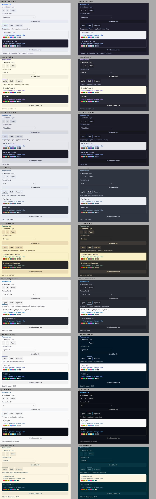
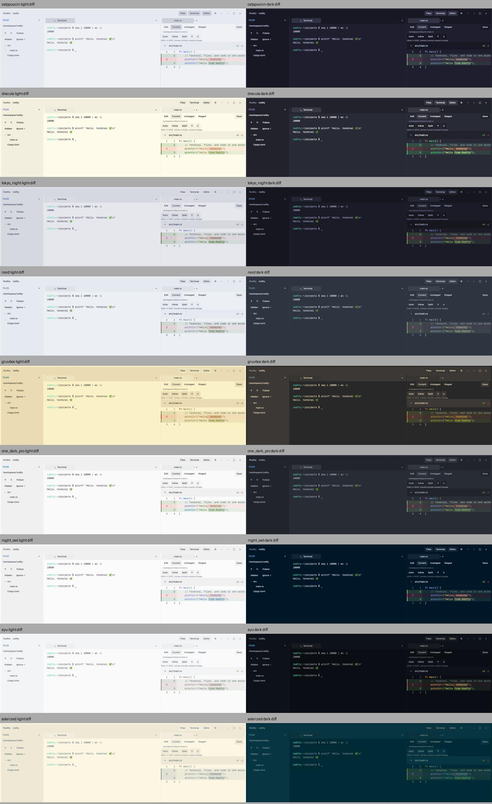

# Appearance verification

The nine families and eighteen appearances use the shared workspace resolver.
[Palette sources and adaptations](../assets/themes/README.md) lists exact RGB
sources, immutable blob pins, full notices, and the deliberately adapted light
palettes. One Dark Pro Light is visibly labelled as a Rodtty adaptation.

Verified on Linux x86-64 on 2026-11-16, against integration `1e947ab`.
The documented serial suite passes all 103 tests with ignored tests included.
Formatting, strict all-targets Clippy, all desktop binaries and the backend
without default features also pass. Test storage uses a dedicated target/tmp
and matching Git ceiling. Windows/macOS native GUI checks remain pending.

The [machine-readable matrix](evidence/appearance-validation.json) records
180 rendered frames and their hashes: all eighteen explicit appearances at
1400×1000, every family's System light/dark appearances at 680×800, plus real
editor selections and open searchable compact theme pickers in all eighteen.
The workspace/editor, Settings/previews, command palette and read-only diff
scenes were inspected for clipping, focus, contrast and readable selections.

The native [Wayland](evidence/appearance-wayland.json) and actual
[Xlib](evidence/appearance-x11.json) lifecycle checks each apply 27 family/mode
changes against the same live terminal session. Output continues afterward,
while the window is closed, and after second-launch reattachment. These native
checks are separate from the labelled sample-content snapshots below.

## Settings and palettes



## Selected editor text


## Read-only diffs



## Compact family picker


## Reproducing a scene

Create an isolated `RODTTY_HOME` under the dedicated target directory, with
`settings.json` containing the desired `theme_family` and `appearance` values.
For example, `{"theme_family":"dracula","appearance":"light"}` selects Alucard.
Then run the normal developer renderer:

```sh
RODTTY_HOME=/path/to/isolated-root target/debug/rodtty \
  --scene workspace --size 1400x1000 --scale 1 --at 1 --snap workspace.png
```

Use `settings`, `diff`, or `palette` for the other labelled scenes. To inspect
System, store `"appearance":"system"` and pass `--theme light` or `--theme dark`.
The app-level tests additionally change host appearance on the same open runtime
at both widths, instead of relying on separate scene startups.
