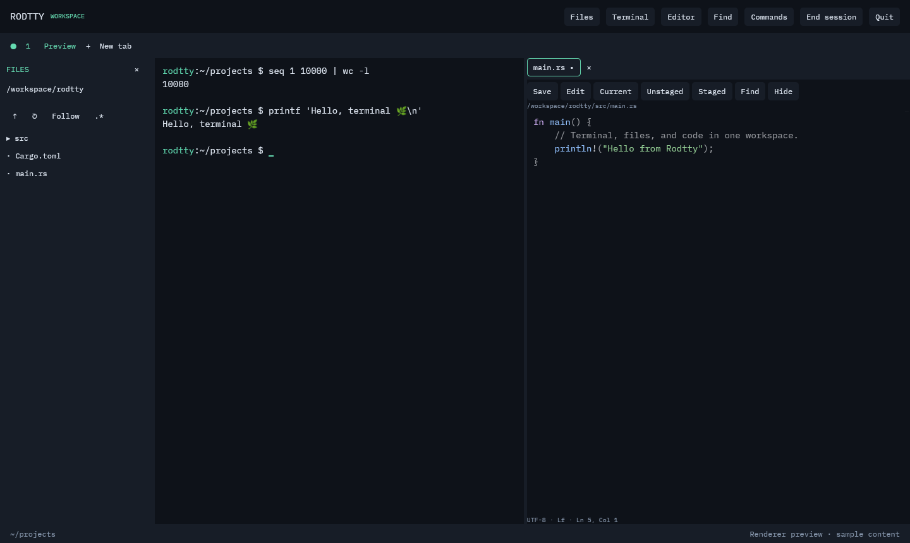
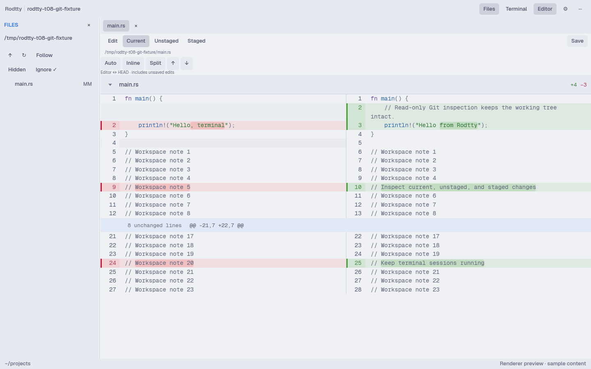

# Desktop implementation report

Validation date: 2026-11-16. Tested host: Linux x86-64 with Rust/Cargo 1.100.0.

## Implemented behavior

The Rune desktop now combines the terminal with a collapsible file explorer and a lightweight editor. The explorer opens at the active terminal's host directory and keeps one chosen root while nested folders expand in place. Follow Terminal reveals the active directory within that root and offers an explicit root change outside it. Hidden-file, Git-ignore and Follow Terminal preferences live in owner Settings JSON. Pane sizes, visibility, active pane, explorer root/expansions/selection, regular editor tabs and terminal-tab order/last directories persist in `~/.rodtty/workspace-state.json`, separately from owner preferences in `~/.rodtty/settings.json`. Workspace changes save periodically and at window close or Quit; temporary previews, unsaved draft text and terminal-title overrides are excluded.

Reopening a running host reattaches the same sessions and recent output. After Quit or restart, saved terminal tabs start fresh shells in their last directories without replaying commands. Behavior settings offers a live, persisted and independently resettable one-fresh-terminal startup choice; it uses the new-terminal directory preference when restoring an existing workspace, while first launch retains the normal startup directory. Changing that preference leaves running sessions intact. Missing saved terminal or explorer folders visibly fall back to the startup folder; missing editor files report an explanation while the remaining files open. Dirty-file decisions still run before close or Quit.

The workspace uses a compact folder header, pane visibility controls, Settings access, and a keyboard-navigable action menu. Infrequent session/window actions live in the menu or Command Palette. Terminal and editor tab strips belong to their respective panes, with a larger initial terminal share and thin draggable dividers. The explorer collapses before the terminal/editor split; below 880 points, terminal and editor become switchable views. Files can reveal the collapsed explorer, and every compact editor or Settings view has a one-action return to the terminal. Resizing does not discard open buffers, terminal sessions, or requested pane widths/visibility. The existing OS window decorations remain until the dedicated window-chrome slice.

Settings opens as an editor-pane tab beside the terminal. Its sections are searchable, existing command/history/scrollback preferences save immediately and reset individually, and Open Settings JSON edits the actual owner file. Valid external edits update the open app; invalid edits retain the last valid configuration and show an explanation. The storage migration preserves original files, existing destinations, history/startup behavior, and both old and new owner-instance locks. Native workspace lifecycle regression checks passed on [Wayland](evidence/settings-storage-wayland.json) and [X11](evidence/settings-storage-x11.json) with isolated storage roots; Windows/macOS native runtime checks remain pending.

The editor provides file tabs, syntax highlighting, undo/redo, find/replace, and saving for UTF-8 text files up to 2 MiB. Saves preserve BOMs, line endings, and file permissions. External changes reload clean buffers automatically; dirty buffers keep their edits and offer conflict resolution. Closing a dirty file/window or quitting offers Save, Discard, or Cancel. Unsaved drafts are not recovered after an application crash.

Autosave remains opt-in through searchable Editor Settings: Explicit Save, After Delay, or Editor Focus Loss. Delay and policy persist in owner preferences and apply live. All policies use the version-protected asynchronous save worker; request generations reject stale completions and later edits remain dirty. File operations and pending owner decisions defer autosave, and failed/cancelled generations do not repeatedly reopen prompts. Diff inspection does not trigger focus-loss saving or mutate the Git index.

Read-only Git inspection uses the host-installed Git executable and supports linked worktrees, untracked files, staged renames, and repositories without a first commit. Current compares the editable buffer with HEAD; Unstaged compares disk with the index; Staged compares the index with HEAD. Inline and side-by-side views include hunk navigation and automatic layout selection. Diff inspection does not save the buffer or modify Git's index.

Filesystem work and Git subprocesses run outside the UI thread. Version checks prevent delayed reload/save results from replacing newer editor text. See [ADR-0006](adr/0006-preserve-file-versions-and-inspect-host-git.md).

## Validation

| Check | Result |
| --- | --- |
| Formatting, strict Clippy, native debug build of all binaries | Passed |
| Unit/runtime tests | 37 passed, including responsive pane/menu controls, preserved drafts and widths, live typography/appearance, explorer hierarchy, and real read-only Git comparisons |
| File/Git integration tests | 12 passed, including conflict protection, BOM/mixed line endings, permissions/symlinks, separate buffer/disk/index/HEAD comparisons, linked worktrees, and index immutability |
| Terminal integration tests, including real Vim and prompt-history error regression | 16 passed |
| Wayland native editor save, unsaved window-close prompt, output while closed, and same-session relaunch | [Passed](evidence/desktop-wayland.json) |
| X11 native editor save, unsaved window-close prompt, output while closed, and same-session relaunch | [Passed](evidence/desktop-x11.json) |
| Compact workspace native lifecycle on Wayland and X11 | [Wayland passed](evidence/compact-workspace-wayland.json), [X11/Xlib passed](evidence/compact-workspace-x11.json); same session, background output, appearance changes, editor save, and dirty-close prompt |
| Windows x86-64 MSVC backend and test compilation, without desktop feature | Passed |
| Apple Silicon macOS backend and test compilation, without desktop feature | Passed |
| Windows/macOS native GUI builds, runtime, clipboard, and window lifecycle | Pending |

Reproduce the local checks with:

```sh
cargo fmt --all -- --check
cargo clippy --locked --all-targets -- -D warnings
cargo build --locked --bins
cargo test --locked --all-targets -- --test-threads=1 --include-ignored
```

The real Vim test requires an installed `vim`. Use a fresh `RODTTY_HOME` for each native lifecycle check in a logged-in desktop session:

```sh
RODTTY_HOME=/tmp/rodtty-desktop-check target/debug/rodtty --workspace-check /tmp/rodtty-desktop-check.json
```

The restoration lifecycle harness uses two invocations with the same isolated `RODTTY_HOME`: first `--restoration-check /absolute/path/live.json`, then `--restoration-check /absolute/path/cold.json --restoration-cold /absolute/path/live.json`. Each invocation exits through explicit Quit. The first checks exact session/shell-process identity, recent output and tab order after closing the window and relaunching while One fresh terminal is selected. The second checks fresh shell PIDs, saved directory order/active tab, absent old output and absent stale title overrides after the stopped host starts again. Place native profiles on the build filesystem so companion binaries can be hard-linked. Linux Wayland and Xlib are separate native checks; Windows/macOS require their own native execution.

## Interface previews

The compact workspace was visually inspected at 1440×900 and 640×360 in light and dark appearances across terminal, editor, Settings, and real Git comparisons. Menu, split, inline, staged, and unstaged render variants were also checked; the fixture file and Git index were byte-for-byte unchanged after all inspection renders.

The workspace, terminal, Settings, and diff scenes can be rendered at wide and minimum sizes with `--scene`, `--snap`, `--size`, and `--theme`. The `real-diff` developer scene reads the first changed text file from an actual Git repository supplied with `--cwd`; it uses the normal read-only inspection boundary. Sample-content scenes remain labelled. Native lifecycle evidence is linked separately above.






## Remaining validation and scope

The owner authorized continuing implementation while Windows and macOS hardware is unavailable. Backend cross-compilation is useful evidence but does not establish native desktop compatibility. The prepared native CI workflow has not been published or executed from this working tree.

This remains a development build. Native Windows/macOS testing, broader clipboard/IME and terminal conformance checks, installers, and packaging remain. The editor deliberately starts with text editing rather than language servers or debugging. Git write operations and browser/PWA remote access, including LAN/Tailscale/Cloudflare configuration, remain later work under the [product scope](product-scope.md).
