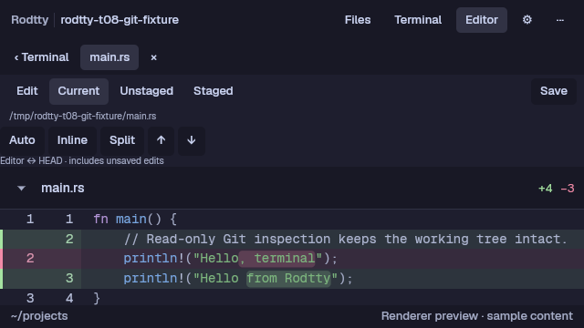

# Desktop implementation report

Validation date: 2026-11-16. Tested host: Linux x86-64 with Rust/Cargo 1.100.0.

## Implemented behavior

The Rune desktop now combines the terminal with a collapsible file explorer and a lightweight editor. The explorer opens at the active terminal's host directory and keeps one chosen root while nested folders expand in place. Follow Terminal reveals the active directory within that root and offers an explicit root change outside it. Hidden-file, Git-ignore and Follow Terminal preferences live in owner Settings JSON. Pane sizes, visibility, explorer root/expansions, and saved file tabs persist in `~/.rodtty/workspace-state.json`, separately from owner preferences in `~/.rodtty/settings.json`.

Settings opens as an editor-pane tab beside the terminal. Its sections are searchable, existing command/history/scrollback preferences save immediately and reset individually, and Open Settings JSON edits the actual owner file. Valid external edits update the open app; invalid edits retain the last valid configuration and show an explanation. The storage migration preserves original files, existing destinations, history/startup behavior, and both old and new owner-instance locks. Native workspace lifecycle regression checks passed on [Wayland](evidence/settings-storage-wayland.json) and [X11](evidence/settings-storage-x11.json) with isolated storage roots; Windows/macOS native runtime checks remain pending.

The editor provides file tabs, syntax highlighting, undo/redo, find/replace, and saving for UTF-8 text files up to 2 MiB. Saves preserve BOMs, line endings, and file permissions. External changes reload clean buffers automatically; dirty buffers keep their edits and offer conflict resolution. Closing a dirty file/window or quitting offers Save, Discard, or Cancel. Unsaved drafts are not recovered after an application crash.

Read-only Git inspection uses the host-installed Git executable and supports linked worktrees, untracked files, staged renames, and repositories without a first commit. Current compares the editable buffer with HEAD; Unstaged compares disk with the index; Staged compares the index with HEAD. Inline and side-by-side views include hunk navigation and automatic layout selection. Diff inspection does not save the buffer or modify Git's index.

Filesystem work and Git subprocesses run outside the UI thread. Version checks prevent delayed reload/save results from replacing newer editor text. See [ADR-0006](adr/0006-preserve-file-versions-and-inspect-host-git.md).

## Validation

| Check | Result |
| --- | --- |
| Formatting, strict Clippy, native debug build of all binaries | Passed |
| Unit tests | 7 passed, including editor keyboard behavior, external changes, explorer following, and diff rendering state |
| File/Git integration tests | 12 passed, including conflict protection, BOM/mixed line endings, permissions/symlinks, separate buffer/disk/index/HEAD comparisons, linked worktrees, and index immutability |
| Terminal integration tests, including real Vim and prompt-history error regression | 15 passed |
| Wayland native editor save, unsaved window-close prompt, output while closed, and same-session relaunch | [Passed](evidence/desktop-wayland.json) |
| X11 native editor save, unsaved window-close prompt, output while closed, and same-session relaunch | [Passed](evidence/desktop-x11.json) |
| Windows x86-64 MSVC backend and test compilation, without desktop feature | Passed |
| Apple Silicon macOS backend and test compilation, without desktop feature | Passed |
| Windows/macOS native GUI builds, runtime, clipboard, and window lifecycle | Pending |

Reproduce the local checks with:

```sh
cargo fmt --all -- --check
cargo clippy --locked --all-targets -- -D warnings
cargo build --locked --bins
cargo test --locked --all-targets -- --test-threads=1 --include-ignored
```

The real Vim test requires an installed `vim`. Use a fresh `RODTTY_HOME` for each native lifecycle check in a logged-in desktop session:

```sh
RODTTY_HOME=/tmp/rodtty-desktop-check target/debug/rodtty --workspace-check /tmp/rodtty-desktop-check.json
```

## Interface previews

These Rune-rendered previews use labelled sample content. Native lifecycle evidence is linked separately above.





## Remaining validation and scope

The owner authorized continuing implementation while Windows and macOS hardware is unavailable. Backend cross-compilation is useful evidence but does not establish native desktop compatibility. The prepared native CI workflow has not been published or executed from this working tree.

This remains a development build. Native Windows/macOS testing, broader clipboard/IME and terminal conformance checks, installers, and packaging remain. The editor deliberately starts with text editing rather than language servers or debugging. Git write operations and browser/PWA remote access, including LAN/Tailscale/Cloudflare configuration, remain later work under the [product scope](product-scope.md).
